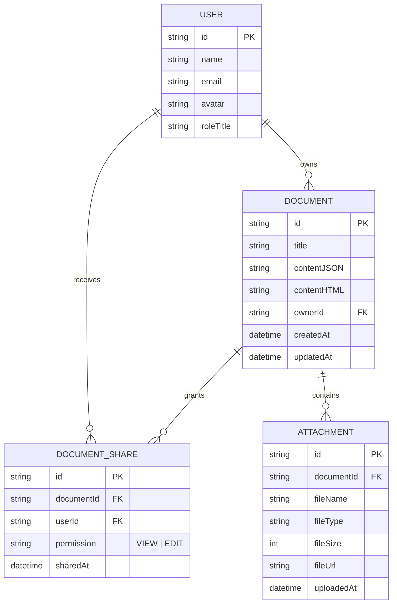
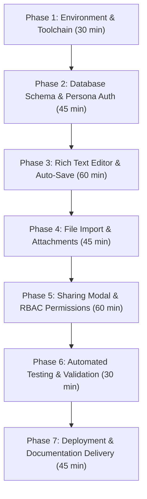

# Project Plan: Ajaia Docs (AI-Native Collaborative Document Editor)
**Candidate:** Sourasish Ghosh (sourasishghosh02@gmail.com)  
**Role:** AI-Native Full Stack Developer Assignment  
**Target Timebox:** 4–6 Hours  
**Date:** November 10, 2026  

---

## 1. Executive Summary & Objective

The objective of this project is to design, build, test, and ship a lightweight collaborative document editor inspired by Google Docs within a realistic 4–6 hour product engineering timebox. Rather than building a superficial clone of Google Docs, the focus is on shipping a **production-grade, cohesive vertical slice** that demonstrates:
1. **Sound Product Judgment:** Thoughtful UX, intentional scope boundaries, and zero-friction evaluator experience.
2. **Full-Stack Competence:** Clean separation of concerns, robust data modeling, persistent state, and permission validation.
3. **AI-Native Engineering:** High-leverage AI utilization for scaffolding, typing, testing, and documentation while maintaining strict architectural oversight.
4. **Reliability & Delivery Discipline:** Automated tests, comprehensive error handling, seamless local execution, and a live deployment.

---

## 2. Core Capabilities & Scope Definition

### 2.1 Document Creation & Editing (Core Feature)
* **Creation:** One-click document creation with immediate URL routing (`/doc/[id]`).
* **Document Metadata:** Inline editing of document title with debounce and instant save status.
* **Rich Text Editing Surface:** Powered by **TipTap / ProseMirror** (the modern standard behind Notion, Linear, and modern rich-text editors):
  * **Typography & Structure:** Headings (H1, H2, H3), Paragraphs, Blockquotes, Horizontal Rules.
  * **Inline Formatting:** Bold, Italic, Underline, Strikethrough, Inline Code.
  * **Lists:** Unordered (bulleted) lists, Ordered (numbered) lists, Task checklists.
  * **Usability & Shortcuts:** Standard keyboard shortcuts (`Ctrl+B`, `Ctrl+I`, `Ctrl+U`), clean floating or sticky formatting toolbar, word count, character count, reading time indicator.
* **Persistence & Auto-save:** Debounced saving (600ms) with visible status indicators (`Saved to Cloud`, `Saving changes...`, `Unsaved changes`).

### 2.2 File Upload & Content Ingestion
* **Product-Relevant Flow:** 
  1. **Document Importer (.txt, .md):** Upload markdown or plain text files to create a brand-new editable document with formatted headings, lists, and typography automatically parsed.
  2. **File Attachments:** Capability to attach reference files (specs, data assets, PDFs, images) directly to any document.
* **UX Safety:** Clear drag-and-drop or file picker zones, client-side format and file size validation (max 5MB), and immediate visual feedback.

### 2.3 Sharing & Access Control Model
* **Ownership Model:** The user who creates the document is designated the **Owner**.
* **Role-Based Access Control (RBAC):**
  * `Owner`: Full administrative rights (edit, rename, share, delete, transfer).
  * `Editor`: Can edit document content and title; cannot modify sharing settings or delete.
  * `Viewer`: Read-only view; formatting toolbar and editor input are strictly disabled; visible "View Only" badge.
* **Visible Segmentation:**
  * **"My Documents"** tab: Documents created and owned by the active user.
  * **"Shared with Me"** tab: Documents shared by other team members, displaying the collaborator's role and the owner's identity.
* **Zero-Friction Persona Switcher:**
  * To allow reviewers to verify multi-user sharing in seconds without signing up or managing OAuth, the app includes a pre-seeded **Team Persona Switcher**:
    * **Alex Rivera** (Engineering Lead - Primary User)
    * **Sarah Chen** (Product Manager)
    * **Jordan Taylor** (UX Designer)
  * Instant session toggling persists across refreshes while testing cross-user sharing permissions.

### 2.4 Persistence & Architecture
* **Persistence Layer:** Relational schema managed via Prisma OR SQLite / PostgreSQL (local zero-setup SQLite file + serverless Postgres compatibility for cloud deployment).
* **Data Integrity:** Foreign keys for user relations, document ownership, share permissions, and attachments.
* **Rehydration:** Accurate state restoration upon page reload, preserving rich-text formatting (HTML / JSON ProseMirror doc structure).

### 2.5 Stretch Goals (If Time Permits)
* Document export (Markdown `.md`, HTML, or Print-ready PDF).
* Collaborator presence pill avatars simulating live team view.
* Document duplicate / template feature.

---

## 3. Technology Stack Selection & Rationale

| Layer | Selected Technology | Rationale |
| :--- | :--- | :--- |
| **Framework** | **Next.js 14/15 (App Router, TypeScript)** | Unified full-stack architecture, API routes / Server Actions, fast SSR/hydration, native Vercel deployment. |
| **Styling & UI** | **Tailwind CSS + Lucide Icons + Radix Primitives** | Fast prototyping, clean Google Docs-like productivity aesthetic, accessible UI components. |
| **Rich Text Engine** | **TipTap (ProseMirror)** | Extensible, battle-tested headless editor supporting bold, italic, underline, headings, lists, and markdown shortcuts out of the box. |
| **Database & ORM** | **SQLite / LibSQL with Prisma OR Drizzle** | Zero-configuration local development (`file:./dev.db`), strict type-safe queries, migration-free schema sync. |
| **Testing** | **Vitest / Jest + React Testing Library** | Lightning-fast unit and integration testing of permissions, file parsing, and document mutations. |
| **Deployment** | **Vercel / Render** | Frictionless 1-click preview and production deployment with automatic SSL and global CDN. |

---

## 4. System Architecture & Data Model

---

## 5. Phased Implementation Roadmap (Timebox: 4–6 Hours)

### Detailed Breakdown

#### Phase 1: Environment & Project Foundation (Est: 30 mins)
* Verify and configure full-stack runtime (Node.js LTS / TypeScript / Next.js).
* Initialize repository with Tailwind CSS, Lucide React, and essential utility libraries.
* Setup modular project directory structure (`/components`, `/lib`, `/types`, `/app/api`).

#### Phase 2: Data Persistence & Persona Engine (Est: 45 mins)
* Configure Prisma / SQLite data layer with schema for `User`, `Document`, `DocumentShare`, and `Attachment`.
* Seed 3 realistic user accounts with distinct profile details.
* Implement a persistent `SessionContext` and header **Persona Switcher** to allow reviewers to switch identities with one click.
* Create CRUD API endpoints/actions for documents (`create`, `get`, `update`, `delete`, `list`).

#### Phase 3: Document Workspace & TipTap Editor (Est: 60 mins)
* Build document list view with search, filter, and sorting.
* Implement the Google Docs-style workspace:
  * Top navigation bar with editable document title, owner indicator, and save status.
  * Custom formatting toolbar (Bold, Italic, Underline, Headings H1-H3, Bullet list, Numbered list, Blockquote, Clear formatting).
  * Auto-save debounce hook syncing to backend on content changes.
* Ensure responsive styling and comfortable reading typography.

#### Phase 4: File Ingestion & Attachment Handling (Est: 45 mins)
* Implement `.md` and `.txt` file uploader:
  * Automatically parse headers, paragraphs, and list items into TipTap schema.
  * Create a new document pre-populated with file name and parsed content.
* Implement document attachment drawer:
  * Allow users to upload supplementary reference files linked to the document.
  * Format and size validation with friendly error messaging.

#### Phase 5: Sharing Model & RBAC Enforcement (Est: 60 mins)
* Build "Share" modal accessible from both the document list and the active editor.
* Add user search / select dropdown from seeded team members.
* Grant `Viewer` or `Editor` access; persist in `DocumentShare` table.
* Implement permission guard:
  * If active persona is `Viewer`: disable TipTap editing (`editable={false}`), hide formatting toolbar, display "View Only" banner.
  * If active persona is `Editor`: allow content editing, restrict sharing management.
  * If active persona is `Owner`: enable all capabilities including delete and share delegation.
* Segment documents dashboard into **"My Documents"** and **"Shared with Me"** tabs.

#### Phase 6: Automated Testing & Quality Assurance (Est: 30 mins)
* Write automated tests covering:
  1. Access control logic: Verify viewers cannot mutate document content and editors cannot delete documents.
  2. File upload parsing: Verify markdown and text files are converted into structured document representations.
  3. Sharing relationships: Ensure shared documents appear in the collaborator's shared list.
* Conduct cross-browser manual verification and error state checks (empty states, 404s, invalid file types).

#### Phase 7: Deployment, Deliverables & AI Documentation (Est: 45 mins)
* Deploy live application to **Vercel** or **Render** and verify live endpoints.
* Author required documentation deliverables:
  * `README.md`: Quickstart, architecture overview, seeded accounts, testing guide.
  * `ARCHITECTURE.md`: Technical tradeoffs, data model, state management decisions, and future roadmap.
  * `AI_WORKFLOW.md`: Explicit reflection on AI tool usage, rejected drafts, and verification process.
  * `SUBMISSION.md`: Consolidated checklist of deliverables, demo accounts, and live links.
* Prepare walkthrough video outline (3–5 minute script).

---

## 6. Strategic Scope & Trade-off Decisions

| Area | Deliberate Scope Choice | Trade-off Rationale |
| :--- | :--- | :--- |
| **Real-time Engine** | Debounced auto-save + optimistic UI updates rather than full WebSocket CRDT (Yjs). | A complete Yjs/WebRTC collaborative sync engine would consume 70% of the 4–6h timebox on network edge cases. Debounced persistence delivers rock-solid reliability, clear RBAC, and zero reviewer flakes. |
| **Authentication** | Seeded Team Persona Switcher instead of live OAuth/Auth0. | Reviewers should not have to sign up with personal Google accounts or deal with email verification to review sharing features. Persona switching allows testing permissions in under 5 seconds. |
| **File Formats** | Markdown (`.md`) and Plain Text (`.txt`) + attachment uploads. | Native client/server markdown-to-doc parsing gives clean rich formatting without bundling heavy binary parsing libraries that can fail across environments. |
| **Database** | Embedded SQLite / LibSQL with Prisma schema. | Zero-config setup for anyone cloning the repo; runs instantly with zero cloud dependencies or external credentials needed locally. |

---

## 7. Deliverables Checklist

- [x] **Project Plan:** `PROJECT_PLAN.md` (Detailed roadmap and architectural blueprint).
- [ ] **Source Code:** Complete Next.js / TypeScript full-stack repository.
- [ ] **Local Run Guide:** `README.md` with step-by-step instructions.
- [ ] **Architecture Note:** `ARCHITECTURE.md` detailing design decisions and tradeoffs.
- [ ] **AI-Native Workflow Note:** `AI_WORKFLOW.md` detailing AI acceleration, rejected outputs, and reliability verification.
- [ ] **Submission Manifest:** `SUBMISSION.md` listing credentials, links, and complete package details.
- [ ] **Automated Test Suite:** Vitest tests verifying permissions, file ingestion, and sharing logic.
- [ ] **Live Deployment:** Working cloud deployment link ready for reviewer testing.
- [ ] **Walkthrough Video Script:** 3–5 minute video presentation outline.

